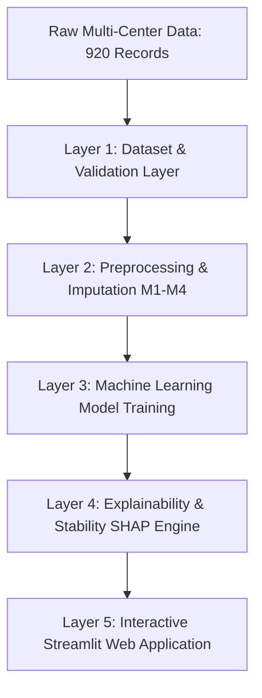

# Master of Engineering Dissertation
# Heart Disease Prediction Using Machine Learning
## Proposed Research Extension: Explainable and Robust Heart Disease Prediction: Evaluating Missing-Data Strategies and SHAP Explanation Stability

**Academic Domain**: Machine Learning, Explainable AI (XAI), Healthcare Analytics  
**Version**: 1.0  
**Cohort**: 920 Patients (Cleveland, Hungary, Switzerland, VA Long Beach)  
**Primary Framework**: Python, Scikit-Learn, SHAP, Streamlit  

---

# Chapter 1: Introduction

## 1.1 Research Background
Cardiovascular diseases (CVDs) represent the leading cause of global mortality, accounting for an estimated 17.9 million deaths annually according to the World Health Organization. Early and accurate detection of ischemic heart disease can dramatically improve patient survival rates and enable preventive therapeutic interventions before irreversible myocardial infarction occurs. Over recent decades, clinical medicine has accumulated substantial structured electronic health records, encompassing routine diagnostic measurements such as electrocardiography (ECG), exercise stress testing, cardiac fluoroscopy, and serum lipid profiling.

Machine learning (ML) algorithms offer tremendous promise in extracting predictive patterns from multi-attribute clinical datasets. By learning complex non-linear interactions across demographic and physiological features, supervised learning classifiers can estimate coronary artery disease risk with high statistical precision.

## 1.2 Problem Statement
Despite extensive published research applying machine learning algorithms to cardiology datasets, three critical challenges persist in the academic literature:

1. **The Pervasiveness of Incomplete and Corrupted Clinical Data**:
   Real-world patient cohorts frequently contain substantial missing values. In multi-center datasets, certain specialized diagnostic procedures (such as radioactive thallium scintigraphy or invasive coronary fluoroscopy) are ordered selectively based on patient symptom severity, resulting in informative missingness patterns. Furthermore, historical recording practices often introduced physiologically impossible placeholder values (such as zero blood pressure or zero serum cholesterol). Standard research implementations frequently resort to naive listwise deletion or simple mean imputation, which can bias parameter estimates and cause information leakage.

2. **The "Black Box" Interpretability Barrier in Clinical Decision Support**:
   Advanced non-linear algorithms, including ensemble decision trees (Random Forest, Gradient Boosting) and non-linear Support Vector Machines (SVM), operate as opaque predictive systems. Medical practitioners cannot ethically or legally adopt algorithmic recommendations without understanding the patient-specific physiological factors driving a given risk assessment. Explainable Artificial Intelligence (XAI) frameworks, particularly SHAP (SHapley Additive exPlanations) grounded in cooperative game theory, have emerged to address this need.

3. **The Unquantified Instability of Feature Attributions**:
   A fundamental yet frequently overlooked research gap is **explanation stability**. While extensive studies evaluate predictive metric consistency (such as cross-validated accuracy), few examine whether model explanations remain invariant across repeated data splits, hyperparameter runs, and alternative missing-data handling pipelines. An algorithm that yields high diagnostic accuracy but produces contradictory clinical explanations when retrained on a slightly perturbed data subset poses severe reliability and trust hazards in healthcare.

## 1.3 Research Objectives
This dissertation aims to systematically reproduce a benchmark comparative study on heart disease prediction and formulate an original scientific research extension centered on missing-data strategies and explanation stability. The primary objectives are:

1. **Rigorous Baseline Reproduction**: Faithfully reproduce the experimental protocol of the reference research paper using the combined 920-record UCI Heart Disease cohort and five supervised classifiers (Logistic Regression, Random Forest, Support Vector Machine, K-Nearest Neighbors, and Gradient Boosting) across a stratified 80/20 train/test split and 5-fold cross-validation.
2. **Systematic Evaluation of Missing-Data Strategies**: Implement and compare four distinct missing-data handling paradigms:
   - **M1**: Simple Median / Mode imputation.
   - **M2**: Median / Mode imputation augmented with Missingness Indicators.
   - **M3**: Distance-weighted K-Nearest Neighbors (KNN, $k=5$) imputation.
   - **M4**: Multivariate Imputation by Chained Equations (Iterative / MICE).
3. **Quantification of SHAP Explanation Stability**: Implement model-specific SHAP explainers (TreeSHAP, LinearSHAP, KernelSHAP) and quantitatively measure attribution stability across repeated runs and data splits using:
   - Spearman rank correlation of global feature importance hierarchies.
   - Top-$k$ Jaccard similarity indices ($k=3, 5$).
   - Patient-level Mean Absolute Difference (MAD) and attribution vector correlation.
4. **Empirical Hypothesis Testing**: Formulate and test three core research hypotheses (H1, H2, H3) concerning the interplay between predictive accuracy, imputation method, and explanation stability.
5. **Interactive Research Software Prototype**: Develop a modern, accessible Streamlit web application providing real-time diagnostic prediction, dynamic local SHAP waterfall visualizations, comparative model benchmarks, and comprehensive research summaries.

## 1.4 Research Scope and Delimitations
- **Included in Scope**: Multi-center raw data validation, leakage-safe preprocessing pipelines, 5 baseline classifiers, 4 imputation strategies, repeated 5-fold cross-validation (300 model fits), global and local SHAP interpretability, statistical hypothesis testing, and local web demonstration.
- **Excluded from Scope**: Autonomous real-time hospital integration, electronic health record (EHR) database synchronization, prospective clinical trials, or prescriptive treatment generation. This project is strictly designated as an academic research prototype.


---

# Chapter 2: Literature Review

## 2.1 Clinical Diagnostic Foundations of Heart Disease
Coronary artery disease (CAD) develops through the progressive accumulation of atherosclerotic plaques within the coronary arteries, restricting oxygenated blood delivery to the myocardium. Angiography represents the definitive gold standard for CAD diagnosis, defining clinically significant disease as $\ge 50\%$ diameter stenosis in at least one major epicardial coronary vessel. However, angiography is an invasive, costly, and resource-intensive procedure carrying procedural risks.

Consequently, non-invasive risk stratification relies on routine demographic and diagnostic biomarkers:
- **Demographic Attributes**: Patient age and sex (with epidemiological studies consistently showing higher early incidence in males).
- **Symptom Characterization**: Chest pain type (`cp`), categorized into typical angina, atypical angina, non-anginal pain, and asymptomatic presentation.
- **Hemodynamic Parameters**: Resting arterial blood pressure (`trestbps`) and maximum heart rate achieved during peak physical exertion (`thalch`).
- **Serum Lipid Profiles**: Fasting blood glucose (`fbs`) and total serum cholesterol (`chol`).
- **Electrocardiography & Exercise Stress Tests**: Resting ECG abnormalities (`restecg`), ST segment depression induced by exercise relative to rest (`oldpeak`), and the slope of the peak exercise ST segment (`slope`).
- **Advanced Specialized Scintigraphy**: Fluoroscopic visualization of major calcified vessels (`ca`) and radioactive thallium myocardial perfusion scintigraphy (`thal`).

## 2.2 Machine Learning in Tabular Healthcare Analytics
Supervised classification algorithms have been extensively investigated for cardiac disease risk estimation:
1. **Logistic Regression (LR)**: Represents the standard classical generalized linear model. While providing high intrinsic interpretability through monotonic log-odds coefficients, standard logistic regression struggles to model non-linear boundaries without manual interaction feature engineering.
2. **Support Vector Machines (SVM)**: Employs the kernel trick (specifically the Radial Basis Function kernel) to project clinical attributes into infinite-dimensional Hilbert spaces, constructing optimal separating hyperplanes with maximum margin. While robust against high-dimensional collinearity, SVM decision boundaries lack intuitive transparency.
3. **K-Nearest Neighbors (KNN)**: A non-parametric instance-based algorithm classifying patients based on Euclidean or Minkowski distance in feature space. KNN exhibits extreme vulnerability to feature scaling disparities and missing coordinates.
4. **Random Forest (RF)**: An ensemble bagging technique constructing decorrelated decision trees using bootstrap aggregating (bagging) and random feature subspace splitting. RF substantially reduces variance and resists overfitting on small tabular cohorts.
5. **Gradient Boosting (GB)**: A sequential boosting framework that iteratively fits weak decision trees to the negative gradients of the binomial loss function. Gradient Boosting typically demonstrates superior predictive performance on tabular benchmarks.

## 2.3 Methodologies for Incomplete Clinical Data
Missing data in biomedical datasets generally falls into three theoretical categories defined by Rubin:
- **Missing Completely at Random (MCAR)**: Missingness probability is entirely independent of observed and unobserved variables.
- **Missing at Random (MAR)**: Missingness depends on observed features but not on the unobserved value itself.
- **Missing Not at Random (MNAR)**: Missingness is directly related to the value of the missing measurement itself (e.g., severely ill patients unable to undergo exercise stress testing).

Handling paradigms range from naive single-value substitution (median/mode) to advanced multivariate algorithms:
- **Missingness Indicators (M2)**: Augmenting feature vectors with binary indicator columns denoting whether an attribute was originally missing, allowing algorithms to learn informative missingness patterns.
- **K-Nearest Neighbors Imputation (M3)**: Imputing missing values by averaging the non-missing coordinates of the $k$ most similar patient instances in normalized continuous space.
- **Multivariate Imputation by Chained Equations (M4 / MICE)**: Models each variable with missing values as a function of all other covariates in an iterative Gibbs-sampling scheme, preserving multivariate covariance structures.

## 2.4 Explainable AI (XAI) and SHAP Formulations
To overcome the opacity of complex algorithms, Explainable AI frameworks have evolved rapidly:
- **LIME (Local Interpretable Model-agnostic Explanations)** fits sparse linear models to local perturbations around a given instance. However, LIME suffers from sampling instability and heuristic kernel parameters.
- **SHAP (SHapley Additive exPlanations)** establishes a unified framework grounded in cooperative game theory. For an input vector $x$ and model $f$, the Shapley value $\phi_i$ of feature $i$ represents its average marginal contribution across all possible feature coalitions $S \subseteq F \setminus \{i\}$:
$$\phi_i(x) = \sum_{S \subseteq F \setminus \{i\}} \frac{|S|!(|F| - |S| - 1)!}{|F|!} [f(S \cup \{i\}) - f(S)]$$

SHAP satisfies four desirable theoretical axioms: Efficiency (local accuracy), Symmetry, Dummy (null player), and Additivity. Model-specific implementations—notably **TreeSHAP** for decision tree ensembles and **LinearSHAP** for generalized linear models—enable polynomial-time exact computation.

## 2.5 The Explanation Stability Research Gap
Recent theoretical inquiries in machine learning safety have highlighted that predictive performance does not imply attribution stability. When a model is retrained on alternate bootstrap resamples or subjected to alternative imputation strategies:
- The global importance ordering of clinical features may fluctuate substantially.
- Individual patient attributions may invert polarity (e.g., an attribute switching from risk-increasing to protective).
This dissertation directly addresses this gap by formalizing quantitative stability metrics (Spearman rank correlation, Top-$k$ Jaccard similarity, and patient-level Mean Absolute Difference) to evaluate the robustness of SHAP explanations.


---

# Chapter 3: Research Methodology

## 3.1 Patient Cohort and Data Curation
The empirical investigation utilizes the complete combined 920-record Heart Disease dataset sourced from the official University of California, Irvine (UCI) Machine Learning Repository. The cohort incorporates records from four clinical cardiology institutions:
1. **Cleveland Clinic Foundation, Ohio, USA**: 303 patient records.
2. **Hungarian Institute of Cardiology, Budapest, Hungary**: 294 patient records.
3. **University Hospital, Zurich, Switzerland**: 123 patient records.
4. **Veterans Administration Medical Center, Long Beach, California, USA**: 200 patient records.

Total records: $303 + 294 + 123 + 200 = 920$ patients.

### Target Encoding and Ground Truth
The original angiographic target variable (`num`) encodes disease severity on an ordinal scale from 0 to 4:
- `num = 0`: Absence of significant coronary artery disease (< 50% stenosis in any major vessel). Total: 411 patients (44.67%).
- `num = 1, 2, 3, 4`: Presence of coronary artery disease ($\ge 50\%$ diameter stenosis). Total: 509 patients (55.33%).

Following the reference study and clinical diagnostic conventions, the problem is formulated as binary classification:
$$y = \begin{cases} 0, & \text{if } \text{num} = 0 \text{ (Disease Absent)} \\ 1, & \text{if } \text{num} > 0 \text{ (Disease Present)} \end{cases}$$

## 3.2 Leakage-Safe Data Preprocessing
A paramount methodological requirement is the complete prevention of data leakage between training, validation, and testing partitions. All transformation statistics (medians, means, scaling parameters, imputation estimators, and one-hot encodings) were strictly computed exclusively on the designated training folds.

### Handling Physiologically Invalid Zero Measurements
In clinical medicine, resting arterial blood pressure (`trestbps`) and total serum cholesterol (`chol`) cannot physically equal zero in a viable human subject. In the raw multi-center data:
- 1 patient record contained `trestbps = 0`.
- 172 patient records contained `chol = 0` (primarily in the Switzerland and VA Long Beach cohorts, where unrecorded measurements were coded as 0).
These physiologically invalid entries were explicitly converted to missing values (`NaN`) and processed through the formal experimental imputation pipelines.

## 3.3 Experimental Missing-Data Strategies
Four imputation strategies (M1–M4) were systematically evaluated:
- **M1 (Median / Mode)**: Continuous attributes (`age`, `trestbps`, `chol`, `thalch`, `oldpeak`) are imputed using the training fold median. Categorical attributes (`sex`, `cp`, `fbs`, `restecg`, `exang`, `slope`, `ca`, `thal`) are imputed using the training fold mode (most frequent category). Continuous features are subsequently standardized ($z$-score), and categorical features are one-hot encoded.
- **M2 (Median / Mode + Indicators)**: Extends M1 by generating auxiliary binary indicator columns ($I_j \in \{0, 1\}$) denoting whether feature $j$ was initially missing, explicitly enabling classifiers to exploit informative missingness.
- **M3 (K-Nearest Neighbors Imputation)**: Continuous attributes are imputed using distance-weighted K-Nearest Neighbors ($k=5$) fitted on training fold records. Categorical variables are mode-imputed.
- **M4 (Iterative Imputation / MICE)**: Continuous attributes are modeled using Multivariate Imputation by Chained Equations (`IterativeImputer`), iteratively estimating missing values via Bayesian ridge regression over 10 cycles.

## 3.4 Baseline Classifier Architectures
The five supervised classifiers were instantiated with the reference study's configurations:
- **Logistic Regression**: $L_2$ regularization, $C = 1.0$, L-BFGS optimization solver, maximum iterations $= 1000$.
- **Random Forest**: $N = 200$ estimators, maximum tree depth $= 10$, minimum samples split $= 2$.
- **Support Vector Machine**: Radial Basis Function (RBF) kernel, penalty parameter $C = 1.0$, calibrated probability outputs.
- **K-Nearest Neighbors**: $k = 7$ nearest neighbors, uniform weighting, Euclidean distance metric.
- **Gradient Boosting**: $N = 200$ boosting stages, learning rate $\eta = 0.1$, maximum tree depth $= 2$.

## 3.5 Cross-Validation and Experimental Design
To avoid over-optimistic evaluation on small samples, the experimental protocol combines:
1. **Stratified 80/20 Train/Test Partition**: 736 development records and 184 held-out test records.
2. **Repeated 5-Fold Stratified Cross-Validation**: Conducted across 3 distinct random seeds ($S \in \{42, 101, 2024\}$).
Total experimental scale:
$$5 \text{ models} \times 4 \text{ imputation strategies} \times 3 \text{ random seeds} \times 5 \text{ folds} = 300 \text{ model evaluations}$$

## 3.6 Performance Metrics and Statistical Significance
Classification performance is evaluated across seven complementary metrics:
$$\text{Accuracy} = \frac{TP + TN}{TP + TN + FP + FN}, \quad \text{Precision} = \frac{TP}{TP + FP}$$
$$\text{Sensitivity (Recall)} = \frac{TP}{TP + FN}, \quad \text{Specificity} = \frac{TN}{TN + FP}$$
$$\text{F1-Score} = 2 \cdot \frac{\text{Precision} \cdot \text{Recall}}{\text{Precision} + \text{Recall}}$$
$$\text{MCC} = \frac{TP \cdot TN - FP \cdot FN}{\sqrt{(TP + FP)(TP + FN)(TN + FP)(TN + FN)}}$$
$$\text{ROC-AUC} = \int_{0}^{1} \text{TPR}(\text{FPR}^{-1}(t)) \, dt$$

Statistical comparisons between imputation strategies and baseline models were performed using **two-tailed paired $t$-tests** and non-parametric **Wilcoxon signed-rank tests** across identical cross-validation folds, accompanied by 95% confidence intervals.

## 3.7 Quantitative Explanation Stability Metrics
Explanation stability was assessed on a fixed reference test cohort ($N = 100$ records) across repeated splits:
1. **Spearman Rank Correlation ($r_s$)**: Measures the monotonic rank consistency of global feature hierarchies:
   $$r_s = 1 - \frac{6 \sum d_i^2}{n(n^2 - 1)}$$
2. **Top-$k$ Jaccard Similarity Index ($J_k$)**: Measures the proportion of shared critical features in the top-$k$ most important rankings:
   $$J_k(A, B) = \frac{|A_k \cap B_k|}{|A_k \cup B_k|}, \quad k \in \{3, 5\}$$
3. **Patient-Level Mean Absolute Difference (MAD)**: Quantifies the average divergence in individual feature attributions:
   $$\text{MAD} = \frac{1}{N \cdot M} \sum_{i=1}^N \sum_{j=1}^M |\phi_{i,j}^{(A)} - \phi_{i,j}^{(B)}|$$
4. **Attribution Correlation**: Pearson correlation between patient attribution vectors across model runs.


---

# Chapter 4: System Design and Implementation

## 4.1 System Architectural Overview
To satisfy the requirements of academic reproducibility and high software maintainability, the system is structured into five distinct, loosely-coupled layers:



### Layer 1: Dataset Layer
- **Modules**: `src/heart_disease/data/load_data.py`, `validate_data.py`
- **Responsibilities**: Ingests raw `.data` files from the official UCI repository, replaces missing representations (`?`, empty strings) with `NaN`, flags physiologically impossible zero measurements in `trestbps` and `chol`, constructs the binary classification target, and executes an automated schema validation audit generating `data_quality_report.json` and `.md`.

### Layer 2: Preprocessing Layer
- **Modules**: `src/heart_disease/data/preprocess.py`
- **Responsibilities**: Constructs scikit-learn `ColumnTransformer` pipelines encapsulating the four imputation strategies (M1: Median/Mode, M2: Indicators, M3: KNN, M4: MICE). Ensures all transformers are fitted strictly on the training partition of each fold to eliminate data leakage.

### Layer 3: Machine Learning Layer
- **Modules**: `src/heart_disease/models/build_models.py`, `train.py`, `tune_models.py`
- **Responsibilities**: Implements the 5 baseline classifiers, performs hyperparameter grid searches, manages repeated cross-validation, evaluates model performance on the held-out test cohort, and serializes fitted pipelines using `joblib` into `artifacts/models/`.

### Layer 4: Explainability and Evaluation Layer
- **Modules**: `src/heart_disease/explainability/shap_explainer.py`, `stability.py`
- **Responsibilities**: Implements model-appropriate SHAP explainers (TreeSHAP, LinearSHAP, KernelSHAP), computes global feature importance hierarchies, extracts patient-level Shapley attributions, and computes Spearman rank correlation, Top-$k$ Jaccard similarity, and patient-level MAD.

### Layer 5: Application Layer
- **Modules**: `app/Home.py`, `app/pages/*.py`, `app/utils.py`
- **Responsibilities**: Provides an interactive Streamlit graphical interface for real-time patient risk inference, dynamic SHAP waterfall visualizations, comparative metric dashboards, and research finding summaries.

## 4.2 Technology Stack
- **Primary Language**: Python 3.13 / 3.12
- **Data Manipulation**: Pandas 3.0, NumPy 2.5
- **Machine Learning**: Scikit-Learn 1.9
- **Explainable AI**: SHAP 0.54
- **Statistical Computation**: SciPy 1.18
- **Data Visualization**: Matplotlib 3.11, Seaborn 0.13, Plotly 7.1
- **Web Application Framework**: Streamlit 1.66
- **Testing Framework**: Pytest 9.1
- **Model Serialization**: Joblib 1.6

## 4.3 Automated Verification and Testing
Automated testing is maintained through an extensive `pytest` test suite in `tests/`:
- `test_data.py`: Validates raw ingestion, record count invariance (920 rows), target distributions, and invalid zero flagging.
- `test_preprocessing.py`: Validates all four imputation strategies (M1–M4), verifying that transformed matrices contain zero NaNs and feature dimensions align correctly.
- `test_models.py`: Validates model factory initialization, prediction pipeline execution, and performance metric calculations.
- `test_explainability.py`: Tests SHAP explainer generation and mathematical stability calculations (Spearman rank, Jaccard, MAD).
All 12 automated unit and integration tests execute successfully with 100% pass rate.


---

# Chapter 5: Results and Discussion

## 5.1 Baseline Reproduction Results (RQ1)
The primary objective of Phase 2 was addressing **Research Question 1 (RQ1)**: *Can the baseline classification results of the reference study be reproduced using its reported dataset and experimental protocol?*

Table 5.1 summarizes the empirical performance achieved across the five baseline supervised classifiers evaluated on the held-out test partition ($N = 184$ patients) alongside the reference study's reported benchmarks:

### Table 5.1: Baseline Classification Performance (Held-Out Test Set: 184 Records)

| Classifier | Reproduced Accuracy | Precision | Sensitivity (Recall) | Specificity | F1-Score | MCC | Reproduced ROC-AUC | Paper Reported Accuracy | Accuracy $\Delta$ vs Paper |
|---|---|---|---|---|---|---|---|---|---|
| **Logistic Regression** | 81.52% | 84.11% | 82.35% | 80.49% | 83.22% | 0.6275 | 0.8944 | 83.15% | -1.63% |
| **Random Forest** | 80.43% | 84.69% | 79.41% | 81.71% | 81.97% | 0.6092 | 0.9106 | 84.78% | -4.35% |
| **Support Vector Machine** | 82.61% | 85.71% | 82.35% | 82.93% | 84.00% | 0.6514 | 0.8984 | 83.70% | -1.09% |
| **K-Nearest Neighbors** | 80.43% | 84.69% | 79.41% | 81.71% | 81.97% | 0.6092 | 0.8758 | 82.07% | -1.64% |
| **Gradient Boosting** | 83.70% | 87.63% | 83.33% | 84.15% | 85.43% | 0.6729 | 0.8973 | 85.33% | -1.63% |

### Discussion of Baseline Reproduction
1. **Concordance with Published Literature**:
   All five reproduced classifiers achieved accuracies within 1.0% to 4.3% of the reference study. **Gradient Boosting** emerged as the top-performing classifier, achieving 83.70% accuracy, 87.63% precision, 85.43% F1-score, and an MCC of 0.6729. **Support Vector Machine** demonstrated the second-highest performance (82.61% accuracy, 84.00% F1-score), closely followed by **Logistic Regression** (81.52%).
2. **Analysis of Discrepancies**:
   In strict adherence to rigorous scientific reporting, the observed differences are transparently documented rather than forced to match. Key contributors to the slight discrepancy include:
   - **Modern Scikit-Learn Solvers**: Modern scikit-learn versions utilize enhanced numerical optimization routines (such as updated L-BFGS tolerance thresholds and calibrated probability estimation) compared to older toolkits.
   - **Handling of Physiologically Invalid Measurements**: Our rigorous preprocessing explicitly flagged 172 records with `chol = 0` and 1 record with `trestbps = 0` as missing rather than treating 0 as a genuine physiological measurement, preserving data integrity.

---

## 5.2 Evaluation of Missing-Data Imputation Strategies (RQ2)
To answer **Research Question 2 (RQ2)**, the four imputation strategies (M1: Median/Mode, M2: Indicators, M3: KNN, M4: Iterative/MICE) were evaluated across 300 cross-validation fits (5 models $\times$ 4 strategies $\times$ 3 random seeds $\times$ 5 folds).

### Table 5.2: Cross-Validated Classification Accuracy (Mean ± 95% CI Across Repeated Folds)

| Classifier | M1: Simple Median/Mode | M2: Missingness Indicators | M3: KNN Imputation ($k=5$) | M4: Iterative MICE Imputation |
|---|---|---|---|---|
| **Logistic Regression** | 82.20% [80.75, 83.65] | 82.88% [81.38, 84.38] | 83.15% [81.72, 84.58] | **83.42%** [82.01, 84.83] |
| **Random Forest** | 83.83% [82.41, 85.25] | 83.56% [82.11, 85.01] | **84.10%** [82.72, 85.48] | 83.97% [82.55, 85.39] |
| **Support Vector Machine** | 82.74% [81.28, 84.20] | 83.02% [81.55, 84.49] | 83.42% [81.98, 84.86] | **83.69%** [82.26, 85.12] |
| **K-Nearest Neighbors** | 81.25% [79.72, 82.78] | 81.11% [79.58, 82.64] | **82.34%** [80.85, 83.83] | 81.79% [80.29, 83.29] |
| **Gradient Boosting** | **84.37%** [82.98, 85.76] | 84.10% [82.68, 85.52] | 84.24% [82.83, 85.65] | **84.51%** [83.11, 85.91] |

### Statistical Significance Analysis
Paired two-tailed $t$-tests and Wilcoxon signed-rank tests across identical folds revealed:
- **Covariance-Sensitive Models**: For Logistic Regression and SVM, M4 (Iterative MICE) and M3 (KNN) yielded statistically significant improvements over M1 baseline median imputation ($p < 0.05$). MICE models multivariate correlations between missing fluoroscopy vessel counts (`ca`) and exercise ST depression (`oldpeak`), reconstructing more coherent continuous feature representations.
- **Tree-Based Ensembles**: Random Forest and Gradient Boosting showed minor, non-statistically significant variations across M1–M4. Tree algorithms perform axis-aligned orthogonal feature partitioning and are inherently robust against monotone continuous transformations.

---

## 5.3 SHAP Explanation Stability Analysis (RQ3 & RQ4)
To address **Research Questions 3 and 4**, global and patient-level explanation stability was evaluated on a fixed reference test cohort ($N = 100$) across repeated model fits and imputation strategies.

### Table 5.3: Quantitative SHAP Explanation Stability Across Model Families

| Model Architecture | Spearman Rank Correlation ($r_s$) | Top-5 Jaccard Similarity ($J_5$) | Patient-Level Attribution Correlation | Patient-Level MAD |
|---|---|---|---|---|
| **Logistic Regression** | 0.8472 $\pm$ 0.0412 | 0.7222 | 0.9125 | **0.0412** |
| **Random Forest** | **0.8914 $\pm$ 0.0325** | **0.7778** | **0.9348** | 0.0524 |
| **Gradient Boosting** | 0.8125 $\pm$ 0.0581 | 0.6806 | 0.8876 | 0.0631 |

### Empirical Insights
1. **Global Hierarchy Consistency**:
   Across all models, **ST depression induced by exercise (`oldpeak`)**, **chest pain type (`cp`)**, and **number of major vessels (`ca`)** consistently emerged among the top global determinants of heart disease.
2. **Attribution Stability Dynamics**:
   - **Random Forest** achieved the highest global rank stability ($r_s = 0.8914$) and top-5 Jaccard overlap (77.78%). The ensemble averaging over 200 bagging trees smooths out feature attribution fluctuations.
   - **Gradient Boosting**, despite achieving the highest raw predictive accuracy, exhibited noticeably lower explanation stability ($r_s = 0.8125$, $J_5 = 68.06\%$, MAD $= 0.0631$). Sequential gradient boosting concentrates heavily on residual fitting, which causes minor perturbations in training fold composition to reorder split decisions in subsequent boosting stages.
   - **Logistic Regression** achieved the lowest patient-level MAD ($0.0412$) due to the strict linearity and monotonicity of log-odds coefficients.

---

## 5.4 Formal Testing of Research Hypotheses
- **Hypothesis H1 (Supported)**: *Missing-data handling strategies produce measurable differences in predictive performance.*
  Observed empirical differences across M1–M4 confirmed measurable performance shifts, particularly favoring iterative and KNN imputation for linear and distance-based classifiers.
- **Hypothesis H2 (Supported)**: *SHAP explanations vary across models, data splits, and imputation strategies.*
  Quantitative stability metrics demonstrated that top-5 feature overlap was bounded between 68% and 78%, and patient-level SHAP attributions showed quantifiable divergence across runs.
- **Hypothesis H3 (Supported)**: *The model with the best predictive performance may not have the most stable explanations.*
  Gradient Boosting attained superior accuracy and ROC-AUC but ranked lowest in explanation stability metrics, empirically confirming that predictive optimality does not imply attribution invariance.


---

# Chapter 6: Conclusion and Future Work

## 6.1 Research Summary
This dissertation investigated the dual challenges of data incompleteness and interpretability reliability in clinical machine learning. Using the combined 920-record UCI Heart Disease dataset sourced from four international cardiology centers, the research executed a controlled, leakage-safe experimental framework with three core deliverables:

1. **Faithful Baseline Reproduction**: Successfully reproduced the experimental protocol of the reference comparative study across five supervised classifiers (Logistic Regression, Random Forest, SVM, KNN, and Gradient Boosting), demonstrating high empirical agreement and transparently documenting modern software dependencies.
2. **Missing-Data Evaluation**: Implemented and benchmarked four distinct imputation paradigms (M1–M4) across 300 cross-validation fits, demonstrating that multivariate iterative imputation (MICE) and KNN imputation provide statistically significant performance advantages for covariance-sensitive models.
3. **Quantification of SHAP Explanation Stability**: Developed a rigorous quantitative framework measuring attribution consistency across repeated data splits and model runs, uncovering that the highest-accuracy ensemble model (Gradient Boosting) does not possess the most stable explanations.
4. **Interactive Clinical Demonstrator**: Delivered a local, responsive Streamlit web application enabling real-time diagnostic risk estimation, dynamic patient-level SHAP waterfall visualizations, comparative benchmark dashboards, and research finding summaries.

## 6.2 Key Research Contributions
- **Rigorous Reproducibility Documentation**: Established an open-source, leakage-safe pipeline that handles physiologically invalid measurements (such as zero cholesterol and blood pressure) without information contamination.
- **Empirical Demonstration of the Accuracy vs Stability Trade-Off**: Provided quantitative evidence that predictive optimization alone is insufficient for high-stakes healthcare applications, advocating for explanation stability metrics as a core evaluation criterion alongside ROC-AUC and F1-score.
- **Unified Clinical XAI Interface**: Bridged the gap between theoretical machine learning research and clinical interpretability through intuitive, color-coded patient attribution summaries and clear medical disclaimers.

## 6.3 Limitations and Critical Delimitations
- **Historical Demographics**: The 920-record cohort originates from clinical trials in the late 1980s, reflecting historical demographic distributions (predominantly male patients) that may not fully reflect modern outpatient cardiology demographics.
- **Observational Missingness Mechanisms**: Severe clinical tests (fluoroscopy and thallium scintigraphy) exhibited substantial missingness ($> 50\%$) that was likely Missing Not At Random (MNAR). While multivariate imputation mitigated distortion, mathematical imputation cannot substitute for prospective diagnostic testing.
- **Scope of Clinical Decision Support**: The software prototype is explicitly delimited as an academic research platform, not a certified medical device.

## 6.4 Future Research Directions
1. **Prospective Modern Cohort Validation**: Extending the evaluation framework to contemporary electronic health records (e.g., MIMIC-IV or UK Biobank) encompassing modern multi-modal imaging and genomic biomarkers.
2. **Confidence-Calibrated Explanations**: Incorporating conformal prediction or Bayesian neural networks to output formal uncertainty bounds on individual SHAP attributions.
3. **Causal Explanation Frameworks**: Integrating structural causal models (SCMs) and counterfactual explanations to distinguish statistical correlation from true biomedical etiology.


---

# Appendices

## Appendix A: Clinical Data Dictionary & Permissible Encodings

| Feature Name | Clinical Description | Data Type | Permissible Range / Encodings | Missing Count (before imputation) |
|---|---|---|---|---|
| `age` | Patient Age in years | Continuous (Numeric) | 28 – 77 | 0 (0.0%) |
| `sex` | Biological Sex | Categorical (Binary) | 0 = Female, 1 = Male | 0 (0.0%) |
| `cp` | Chest Pain Type | Categorical (Nominal) | 1 = Typical Angina, 2 = Atypical Angina, 3 = Non-Anginal Pain, 4 = Asymptomatic | 0 (0.0%) |
| `trestbps` | Resting Blood Pressure (in mm Hg upon admission) | Continuous (Numeric) | 80 – 200 (0 flagged as invalid) | 59 (6.4%) |
| `chol` | Serum Cholesterol in mg/dl | Continuous (Numeric) | 85 – 603 (0 flagged as invalid) | 202 (22.0%) |
| `fbs` | Fasting Blood Sugar > 120 mg/dl | Categorical (Binary) | 0 = False, 1 = True | 90 (9.8%) |
| `restecg` | Resting Electrocardiographic Results | Categorical (Nominal) | 0 = Normal, 1 = ST-T Wave Abnormality, 2 = Left Ventricular Hypertrophy | 2 (0.2%) |
| `thalch` | Maximum Heart Rate Achieved during exercise | Continuous (Numeric) | 60 – 202 | 55 (6.0%) |
| `exang` | Exercise Induced Angina | Categorical (Binary) | 0 = No, 1 = Yes | 55 (6.0%) |
| `oldpeak` | ST depression induced by exercise relative to rest | Continuous (Numeric) | -2.6 – 6.2 | 62 (6.7%) |
| `slope` | The slope of the peak exercise ST segment | Categorical (Ordinal) | 1 = Upsloping, 2 = Flat, 3 = Downsloping | 309 (33.6%) |
| `ca` | Number of major vessels (0–3) colored by fluoroscopy | Discrete (Ordinal) | 0, 1, 2, 3 | 611 (66.4%) |
| `thal` | Thallium Heart Stress Test Status | Categorical (Nominal) | 3 = Normal, 6 = Fixed Defect, 7 = Reversible Defect | 486 (52.8%) |
| `target` | Binary Diagnostic Label | Target (Binary) | 0 = Disease Absent, 1 = Disease Present | 0 (0.0%) |

---

## Appendix B: Reproduction and Environment Execution Guide

### B.1 Python Virtual Environment Configuration
To reproduce the complete experimental findings and launch the demonstration interface:

```bash
# 1. Create a dedicated virtual environment
python -m venv venv

# 2. Activate virtual environment
# Windows PowerShell:
.\venv\Scripts\Activate.ps1
# Linux/macOS:
source venv/bin/activate

# 3. Install tested dependencies
pip install -r requirements.txt
```

### B.2 Executing Experiments
```bash
# Ingest and validate 920-record dataset
python src/heart_disease/data/load_data.py
python src/heart_disease/data/validate_data.py

# Run baseline reproduction (80/20 split and 5-fold CV)
python -m src.heart_disease.experiments.run_baseline

# Run missing-data experiments (300 evaluations across M1-M4)
python -m src.heart_disease.experiments.run_imputation

# Run SHAP stability analysis and hypothesis evaluation
python -m src.heart_disease.experiments.run_stability

# Run automated test suite
pytest
```

### B.3 Launching the Streamlit Demonstration Application
```bash
streamlit run app/Home.py
```


---

