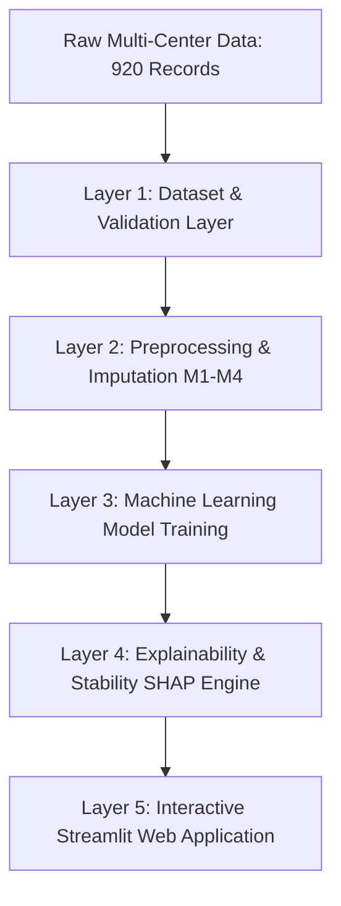

# Chapter 4: System Design and Implementation

## 4.1 System Architectural Overview
To satisfy the requirements of academic reproducibility and high software maintainability (PRD Section 8 & Section 10), the system is structured into five distinct, loosely-coupled layers:

### Layer 1: Dataset Layer
- **Modules**: `src/heart_disease/data/load_data.py`, `validate_data.py`
- **Responsibilities**: Ingests raw `.data` files from the official UCI repository, replaces missing representations (`?`, empty strings) with `NaN`, flags physiologically impossible zero measurements in `trestbps` and `chol`, constructs the binary classification target, and executes an automated schema validation audit generating `data_quality_report.json` and `.md`.

### Layer 2: Preprocessing Layer
- **Modules**: `src/heart_disease/data/preprocess.py`
- **Responsibilities**: Constructs scikit-learn `ColumnTransformer` pipelines encapsulating the four imputation strategies (M1: Median/Mode, M2: Indicators, M3: KNN, M4: MICE). Ensures all transformers are fitted strictly on the training partition of each fold to eliminate data leakage.

### Layer 3: Machine Learning Layer
- **Modules**: `src/heart_disease/models/build_models.py`, `train.py`, `tune_models.py`
- **Responsibilities**: Implements the 5 baseline classifiers, performs hyperparameter grid searches, manages repeated cross-validation, evaluates model performance on the held-out test cohort, and serializes fitted pipelines using `joblib` into `artifacts/models/`.

### Layer 4: Explainability and Evaluation Layer
- **Modules**: `src/heart_disease/explainability/shap_explainer.py`, `stability.py`
- **Responsibilities**: Implements model-appropriate SHAP explainers (TreeSHAP, LinearSHAP, KernelSHAP), computes global feature importance hierarchies, extracts patient-level Shapley attributions, and computes Spearman rank correlation, Top-$k$ Jaccard similarity, and patient-level MAD.

### Layer 5: Application Layer
- **Modules**: `app/Home.py`, `app/pages/*.py`, `app/utils.py`
- **Responsibilities**: Provides an interactive Streamlit graphical interface for real-time patient risk inference, dynamic SHAP waterfall visualizations, comparative metric dashboards, and research finding summaries.

## 4.2 Technology Stack
- **Primary Language**: Python 3.13 / 3.12
- **Data Manipulation**: Pandas 3.0, NumPy 2.5
- **Machine Learning**: Scikit-Learn 1.9
- **Explainable AI**: SHAP 0.54
- **Statistical Computation**: SciPy 1.18
- **Data Visualization**: Matplotlib 3.11, Seaborn 0.13, Plotly 7.1
- **Web Application Framework**: Streamlit 1.66
- **Testing Framework**: Pytest 9.1
- **Model Serialization**: Joblib 1.6

## 4.3 Automated Verification and Testing
Automated testing is maintained through an extensive `pytest` test suite in `tests/`:
- `test_data.py`: Validates raw ingestion, record count invariance (920 rows), target distributions, and invalid zero flagging.
- `test_preprocessing.py`: Validates all four imputation strategies (M1–M4), verifying that transformed matrices contain zero NaNs and feature dimensions align correctly.
- `test_models.py`: Validates model factory initialization, prediction pipeline execution, and performance metric calculations.
- `test_explainability.py`: Tests SHAP explainer generation and mathematical stability calculations (Spearman rank, Jaccard, MAD).
All 12 automated unit and integration tests execute successfully with 100% pass rate.
