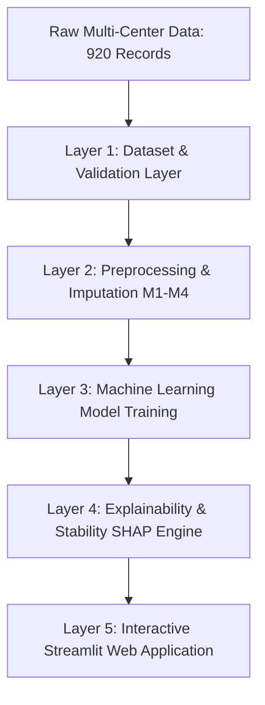

# System Architecture & Technical Specifications

## 1. Five-Layer Architecture Overview
The system implements a five-layer decoupled design ensuring modularity, reproducibility, and zero data leakage:

---

## 2. Layer Specifications

### Layer 1: Dataset Layer
- **`src/heart_disease/data/load_data.py`**:
  - Ingestion from 4 clinical sites: Cleveland (303), Hungary (294), Switzerland (123), VA Long Beach (200).
  - Handles missing representations (`?`, empty strings) converted to `NaN`.
  - Converts physiologically invalid zero measurements (`trestbps=0`, `chol=0`) to `NaN`.
  - Maps target `num` to binary `target` ($0 = \text{Absent}$, $1..4 = \text{Present}$).
  - Stratified 80/20 train/test partition (736 development records, 184 held-out test records).
- **`src/heart_disease/data/validate_data.py`**:
  - Enforces schema assertions, record count (920), class distributions, and generates `results/logs/data_quality_report.json` and `.md`.

### Layer 2: Preprocessing Layer
- **`src/heart_disease/data/preprocess.py`**:
  - Constructs scikit-learn `ColumnTransformer` pipelines.
  - Implements the 4 Missing-Data Imputation Strategies:
    - **M1**: Median (continuous) / Mode (categorical) + StandardScaler + OneHotEncoder.
    - **M2**: Median/Mode with `MissingIndicator` features.
    - **M3**: Distance-Weighted K-Nearest Neighbors Imputation (`KNNImputer`, $k=5$).
    - **M4**: Multivariate Imputation by Chained Equations (`IterativeImputer` / MICE, 10 iterations).
  - **Leakage Prevention**: All transformers are fitted strictly on training partitions within each fold.

### Layer 3: Machine Learning Layer
- **`src/heart_disease/models/build_models.py`**:
  - Classifier factory for the 5 supervised models: Logistic Regression, Random Forest, SVM, KNN, Gradient Boosting.
- **`src/heart_disease/models/train.py`**:
  - Pipeline fitting, test set evaluation, and Joblib serialization to `artifacts/models/`.
- **`src/heart_disease/models/tune_models.py`**:
  - Hyperparameter grid searches over defined parameter spaces in `configs/models.yaml`.

### Layer 4: Explainability & Evaluation Layer
- **`src/heart_disease/evaluation/metrics.py`**:
  - Computes Accuracy, Precision, Recall, Specificity, F1, MCC, ROC-AUC, and Confusion Matrices.
- **`src/heart_disease/evaluation/cross_validation.py`**:
  - Repeated Stratified K-Fold CV runner (5 folds $\times$ 3 seeds).
- **`src/heart_disease/evaluation/statistics.py`**:
  - Paired $t$-tests, Wilcoxon signed-rank tests, and 95% confidence intervals.
- **`src/heart_disease/explainability/shap_explainer.py`**:
  - Model-specific SHAP explainers (TreeSHAP, LinearSHAP, KernelSHAP) and waterfall visualizations.
- **`src/heart_disease/explainability/stability.py`**:
  - Spearman rank correlation, Top-$k$ Jaccard similarity, and patient-level Mean Absolute Difference (MAD).

### Layer 5: Application Layer
- **`app/Home.py`**: Executive summary, interactive KPIs, architecture diagram, and cohort table.
- **`app/pages/1_Prediction.py`**: Real-time diagnostic inference with clinical ranges and probability gauge meter.
- **`app/pages/2_Explanation.py`**: Local patient SHAP waterfall bar charts and plain-language medical narratives.
- **`app/pages/3_Model_Performance.py`**: Comparative benchmark dashboard loaded from saved experiment CSVs.
- **`app/pages/4_Research_Findings.py`**: Formal hypothesis testing (H1–H3) and explanation stability analysis.
